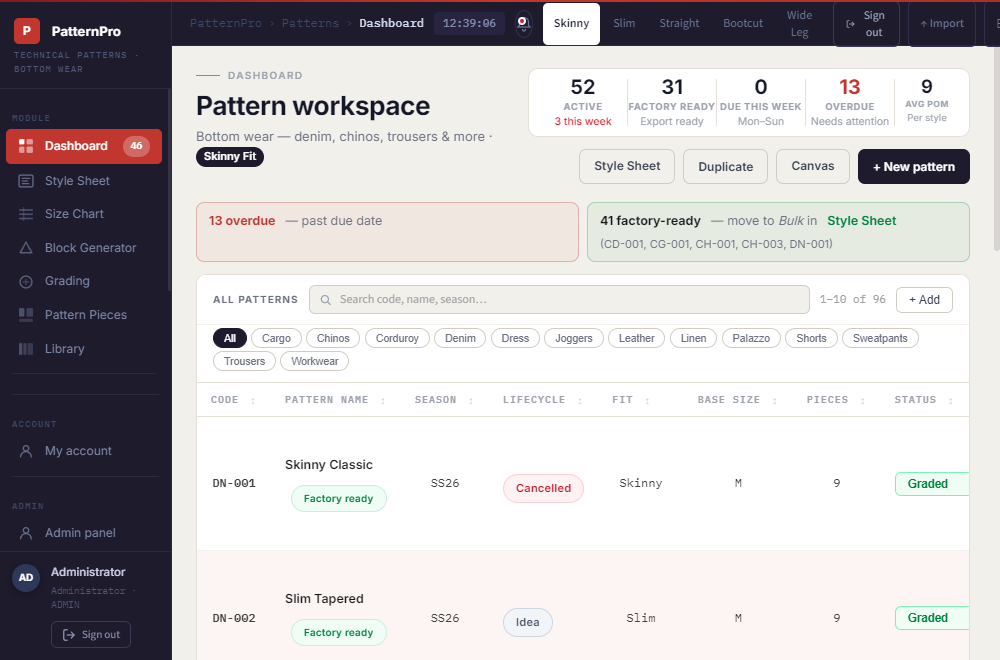
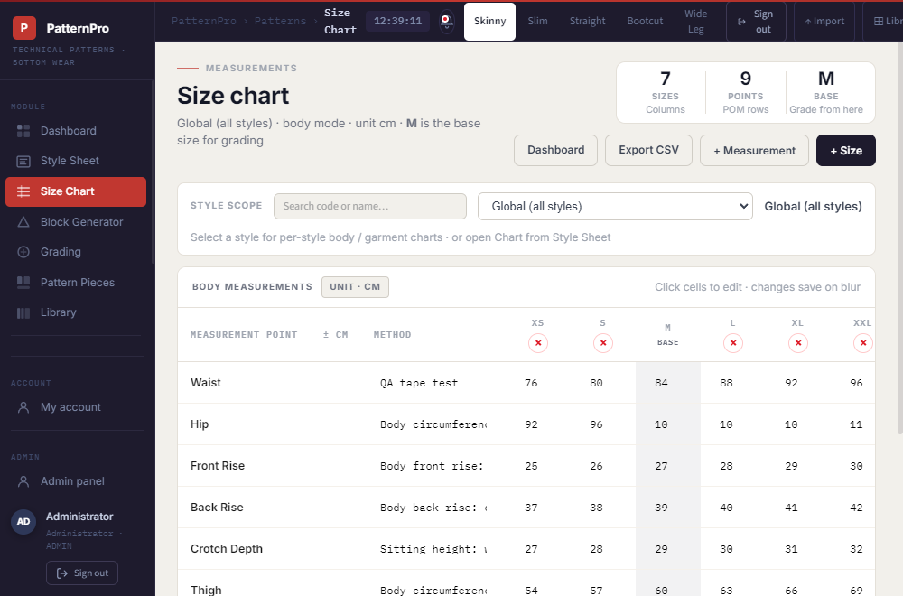
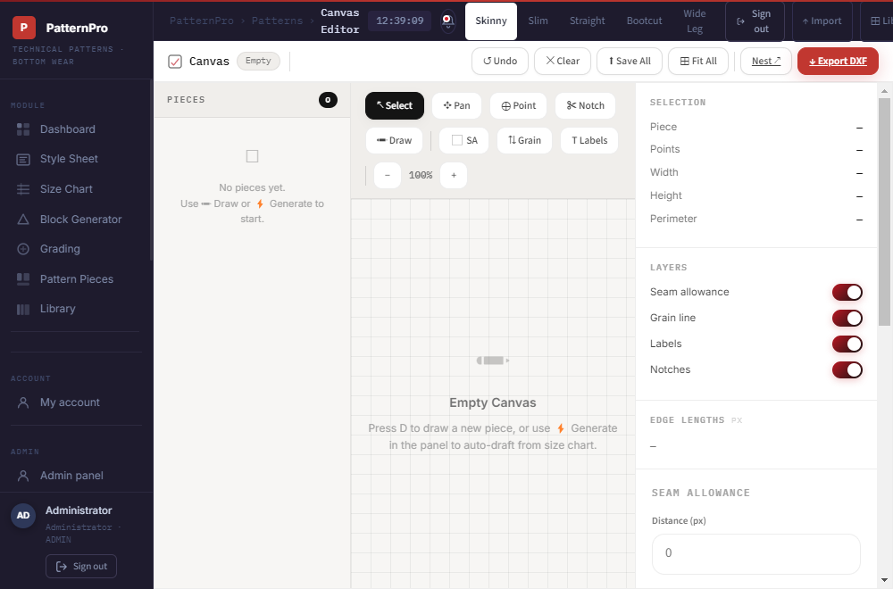
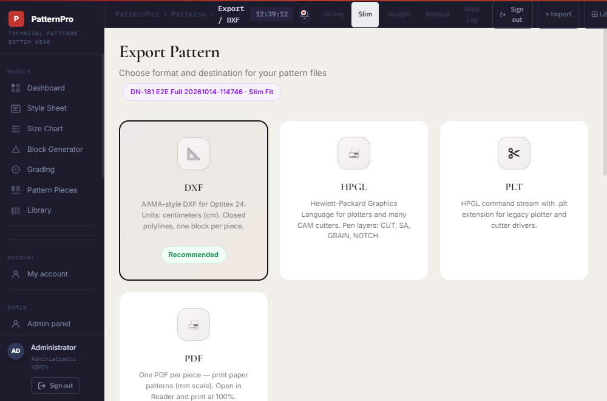

# PatternPro

**PatternPro** is a full-stack **trouser and denim pattern-making system** with lightweight PLM. It takes a style from registration through size charts, grading, 2D piece editing, and **factory-certified export** (DXF, HPGL, PLT, PDF). Use it in the **browser** (`Pattern.Web`) or as a **Windows desktop app** (`PatternPro.Desktop`) — both share the same backend and PostgreSQL database.

**Repository:** https://github.com/farhanaaurora97/PatternMaking

---

## Screenshots

Save PNG captures to `docs/screenshots/` with these names, then they render on GitHub:

| Dashboard | Size Chart |
|-----------|------------|
|  |  |

| Canvas | Export |
|--------|--------|
|  |  |

**How to capture:** with Web on `:5001`, run `npm run cy:screenshots --prefix e2e`, then `powershell -File tools/copy-readme-screenshots.ps1`. Or save PNGs manually with **Win+Shift+S**.

---

## Quick start

**Prerequisites:** [.NET 8 SDK](https://dotnet.microsoft.com/download/dotnet/8.0). Optional: PostgreSQL 14+ (port **5433**). For Desktop: Windows 10+ and MAUI workload (`dotnet workload install maui`).

### Login (local pilot)

| Field | Value |
|-------|-------|
| Username | `admin` |
| Password | `Admin@123` |

### Run Web (browser)

```powershell
cd PatternMaking\Pattern.Web
dotnet run
```

Open **http://localhost:5001**

> **Web and Desktop** share the same PostgreSQL database. You can run either app alone, or both at the same time.

### Run Desktop (Windows)

```powershell
cd PatternMaking
dotnet run --project PatternPro.Desktop\PatternPro.Desktop.csproj
```

Or launch a Release build:

```powershell
powershell -ExecutionPolicy Bypass -File tools\qa-desktop-test.ps1 -LaunchOnly
```

Export ZIPs and CSV files save to your **Downloads** folder (`C:\Users\<you>\Downloads\`).

### Build Desktop ZIP (share with others)

```powershell
powershell -ExecutionPolicy Bypass -File tools\publish-desktop-windows.ps1
```

Output: `dist\PatternPro-Desktop-1.0-win-x64.zip`

---

## Tech stack

| Layer | Technology |
|-------|------------|
| Backend | ASP.NET Core 8 (.NET 8) |
| Web UI | ASP.NET Core MVC, Razor, Vanilla JavaScript, HTML5 Canvas |
| Desktop UI | .NET MAUI, Blazor, SkiaSharp |
| Database | PostgreSQL 14+ (EF Core 8 + Npgsql) or JSON (`App_Data/`) |
| Testing | xUnit, PowerShell QA scripts, Cypress E2E |
| Export | AAMA DXF, HPGL, PLT, PDF (PdfSharpCore) |

---

## What you can do

| Module | Description |
|--------|-------------|
| **Dashboard** | Pattern CRUD, KPIs, lifecycle alerts, Factory ready count |
| **Style Sheet** | PLM register — season, designer, owner, lifecycle |
| **Size Chart** | Global or **per-style** charts; body vs garment mode; CSV export |
| **Block Generator** | Fit profiles and ease overrides |
| **Grading** | Style-specific grade deltas between sizes |
| **Pattern Pieces** | Piece library, fabric cut summary, link to canvas |
| **Canvas** | 2D pattern editor — geometry, grain, notches, multi-size draft |
| **Graded Nest** | Graded size overlay |
| **Library** | Browse all patterns |
| **Export** | Factory ZIP gated by QC + approval + cutter test |

**Typical workflow:** Style Sheet → Size Chart → Block Generator → Grading → Pattern Pieces → Canvas → Export

---

## PostgreSQL setup (optional)

Copy `Pattern.Web/appsettings.Development.example.json` → `appsettings.Development.json` and set:

```json
{
  "ConnectionStrings": {
    "Postgres": "Host=localhost;Port=5433;Database=patternpro;Username=postgres;Password=YOUR_PASSWORD"
  }
}
```

If `ConnectionStrings:Postgres` is **present**, the app uses PostgreSQL; otherwise JSON files in `Pattern.Web/App_Data/`.

---

## Testing

```powershell
# Unit tests
dotnet test PatternPro.Tests/PatternPro.Tests.csproj

# Full E2E (Web must be running on :5001)
powershell -ExecutionPolicy Bypass -File tools/qa-full-e2e.ps1

# Size chart module (44 tests)
powershell -ExecutionPolicy Bypass -File tools/qa-size-chart-test.ps1

# Cypress (optional)
powershell -ExecutionPolicy Bypass -File tools/qa-cypress.ps1
```

---

## Project structure

```
PatternMaking/
├── Pattern.Web/              # Main browser app (localhost:5001)
├── PatternPro.Desktop/       # Windows MAUI desktop app
├── PatternPro.Business/      # Service layer
├── PatternPro.DataAccess/    # PostgreSQL + JSON persistence
├── PatternPro.Tests/         # Unit tests
├── tools/                    # QA scripts, publish, DbTool
└── docs/                     # Full guides (see below)
```

---

## Documentation

| Document | Purpose |
|----------|---------|
| [docs/PROJECT_GUIDE.md](docs/PROJECT_GUIDE.md) | Complete guide — start here for team / factory |
| [docs/TESTING.md](docs/TESTING.md) | Manual and automated testing |
| [docs/DEPLOYMENT.md](docs/DEPLOYMENT.md) | Production publish and HTTPS |
| [docs/PRODUCTION_CERTIFICATION.md](docs/PRODUCTION_CERTIFICATION.md) | Factory QC and export gating |
| [docs/ADMIN_PANEL.md](docs/ADMIN_PANEL.md) | Users and roles |

---

## Factory certification

Factory CAM download requires:

1. **Geometry QC** — required pieces present; errors block export
2. **Design approval** — Approve for cutting on Export
3. **Cutter/plotter test** — Record pass on real equipment

Until all pass, **Factory export** is disabled. **Draft** and **CLO review** exports are not gated.

---

## Fits supported

Skinny, Slim, Straight, Bootcut, Wide Leg — sizes XS through XXL (base size usually M).

---

## Troubleshooting

| Issue | Fix |
|-------|-----|
| Port 5001 in use | `taskkill /IM Pattern.Web.exe /F` then restart |
| Desktop won't connect | Check PostgreSQL in `appsettings.Development.json`; Web and Desktop use the same DB (Web on :5001 is optional) |
| Factory ready stays 0 | Complete approve + cutter pass on Export page |
| Data not updating | Confirm console shows **PostgreSQL**; restart app |

---

## License

See repository settings on GitHub for license terms.
